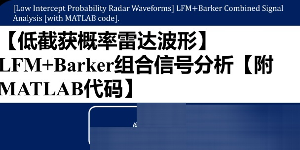

# Low Probability of Intercept (LPI) Radar Waveforms: Analysis of LFM+Barker Combination Signals with MATLAB Code Attached

1. Requirements for Design and Analysis of Low-Intercept Radar Waveforms
When selecting radar transmission waveforms, the first consideration should be to select a radar signal with as low peak power as possible, as wide a bandwidth as possible, and as closely resemble an ideal pin-shaped signal in its envelope. Secondly, in terms of the composition structure of the waveform, one should opt for signals that are complex and difficult for the opponent to recognize. Finally, from the perspective of ease of implementation and processing, it is advisable to choose waveforms that are easier to implement and process in engineering.
Continuous wave radars without modulation cannot measure target distances; therefore, to measure target distance and speed, the transmit frequency must vary over time, and the correlation between the echo signal and the transmitted signal can provide a measure of the target's distance and Doppler information. However, modulation cannot always change continuously (such as increasing or decreasing) along one direction, so generally, period modulation is adopted.
While being the most commonly used waveform, biphase coding signals struggle to provide low sidelobe levels and good Doppler tolerance. For radar designers, multiphase coding is more useful, as it offers more phase shift values in its subcodes, allows for much longer encoding periods, and simultaneously provides better sidelobe performance and Doppler tolerance.
Continuous wave radars without modulation cannot measure target distances; therefore, to measure target distance and speed, the transmit frequency must vary over time, and the correlation between the echo signal and the transmitted signal can provide a measure of the target's distance and Doppler information. However, modulation cannot always change continuously (such as increasing or decreasing) along one direction, so generally, period modulation is adopted.
While being the most commonly used waveform, biphase coding signals struggle to provide low sidelobe levels and good Doppler tolerance. For radar designers, multiphase coding is more useful, as it offers more phase shift values in its subcodes, allows for much longer encoding periods, and simultaneously provides better sidelobe performance and Doppler tolerance.

## Images

<!-- PAYMENT_BLOCK -->

## Get this dataset

- Payment link (Stripe): [Buy now](https://buy.stripe.com/3cs8yP7sY87d0vu9AB)
- Payment QR code: 

<!-- /PAYMENT_BLOCK -->
